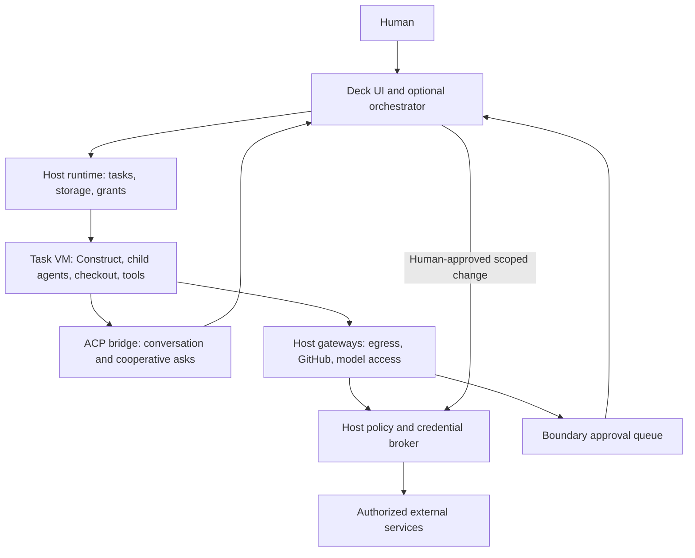

# Sandbox design discussion

November 1, 2026. Research and recommendations, not accepted architecture or an implementation plan. This supplements `PLAN.md` with the user's latest direction: GitHub-first review, external enforcement, and reliable project dependencies.

## Recommended starting point

A project owns a versioned environment definition. A task owns an isolated checkout, a writable disk, a branch, and its runtime grants. Several cooperating agents can share that task's VM when they are intended to share authority and files. Independent tasks reuse the environment but do not share writable state.

Deck owns the user workflow and approvals. A headless host runtime enforces the decisions even with the window closed. Construct runs inside the guest and can edit, execute, install, and delegate within its assigned resources. It cannot change host policy. The future Deck orchestrator gets scoped runtime operations, not an unrestricted host shell or authority to approve its own requests.

This describes logical responsibilities, not separate mandatory services. The network arrangement must make the gateways the only external route. Guest proxy environment variables alone do not enforce anything.

## What the existing implementations establish

### Deck and Construct

Deck currently launches a local child directly and kills it when its `Agent` handle drops. Since #14 the connection (`Client`) is separate and can run over a socket the client did not launch. That lifecycle is appropriate for the spike but does not provide persistent VM tasks. See [process.rs](crates/deck-acp/src/process.rs), lines 25 and 52. Its ACP client already handles `session/request_permission` and advertises no client filesystem or terminal operations. See [conn.rs](crates/deck-acp/src/conn.rs), lines 84 and 135.

Construct's ACP server does not install an upward permission asker. `Perms::new` defaults to `NoAsk`; the JSONL child transport does install an asker. See [ACP server](../construct/crates/construct/src/acp/server.rs), lines 98 and 138, [permission defaults](../construct/crates/construct/src/permission/perms.rs), line 49, and [ADR 0016](../construct/docs/adr/0016-permission-prompts.md), line 42. ACP itself supports permission requests, but its [security model](https://github.com/agentclientprotocol/agent-client-protocol/blob/main/docs/protocol/v1/security.mdx) makes those requests cooperative. External enforcement must work without them.

Construct already assumes host toolchains and caches in its process sandbox configuration. Those path allowances do not provision dependencies in a new guest. No dedicated GitHub branch or PR integration was found in its Rust source. Its Git remote handling identifies projects for shared learning. See [sandbox defaults](../construct/crates/construct/src/sandbox/mod.rs), lines 113 and 159, and [project identity](../construct/crates/construct/src/project.rs), line 22.

### Substrate

The remembered latency is supported by historical records. The [VMM decision record](../substrate_v3/docs/proposals/09-vmm-choice.md), lines 20–25, reports macOS launch-to-completed-command medians of 334 ms with QEMU and 266 ms with libkrun. A later [Mac validation](../substrate_v3/docs/proposals/03-mac-pidfd-handoff.md), line 110, reports 353 ms fresh-launch median and roughly 3 ms command round trip in a running guest. These were not rerun for this discussion. Some later raw benchmark artifacts are absent from the checkout.

Named toolchain layers shipped. A recipe declared Alpine and Python packages plus import checks. Baking used a networked VM, installed and verified packages, checkpointed a qcow2 overlay, and recorded hashes and versions. Workspace import built a baseline on that layer, followed by a writable working overlay. See [layer schema and validation](../substrate_v3/src/sandbox/layers.ts), lines 8 and 145, [bake lifecycle](../substrate_v3/scripts/layer-build.ts), line 79, and [workspace publication](../substrate_v3/src/sandbox/workspace.ts), line 162.

Automatic project dependency layers keyed by toolchain and lockfiles remained [a proposal](../substrate_v3/docs/proposals/07-dependencies.md). Runtime egress approvals also remained [proposed](../substrate_v3/docs/proposals/04-runtime-egress.md). The implemented agent VM had networking disabled and no shared host filesystem. See [runtime options](../substrate_v3/src/sandbox/gondolin.ts), lines 63–86.

Local application was hash-based file write-back with conflict refusal, safe directory traversal, and per-file atomic writes. It was not Git merging. See [apply.ts](../substrate_v3/src/host/apply.ts), lines 1 and 104. GitHub-first avoids extending that bespoke reconciliation path.

### Minimal and libkrun

Minimal separates a read-only ext4 root, an initramfs daemon, and a writable per-VM data disk. Its launcher attaches daemon and network channels over vsock; network traffic goes through a host egress gate. See [vm.rs](https://github.com/gominimal/minimal/blob/6bddc077cabe6caf0420f8d300fb582428c62a80/crates/minvmd/src/vm.rs#L169), configuration beginning at line 316 and network setup at line 456.

Its environment builder resolves declared packages and their transitive runtime closure, builds missing packages, caches results, and assembles root filesystem layers. This is a substantial custom package ecosystem, not just an OCI image launcher. See [env.rs](https://github.com/gominimal/minimal/blob/6bddc077cabe6caf0420f8d300fb582428c62a80/crates/minimald/src/env.rs#L486), and layers beginning at line 588. The useful lessons are separation of immutable environments from task data, explicit environment identity, and host-routed networking. Adopting its entire dependency system would be a separate product commitment.

libkrun uses KVM on Linux and Hypervisor.framework on supported macOS hosts. KVM is not the macOS backend. Upstream's [networking warning](https://github.com/libkrun/libkrun#networking) matters: transparent socket networking inherits the VMM's host networking access. A VM boundary does not automatically restrict the VMM's exposed devices, paths, or network authority. At research time upstream main also warns of breaking 2.0 API changes and recommends a stable branch for production. Pin and evaluate a specific release.

### Coop

Coop uses Firecracker on Linux and Lima on macOS. It demonstrates reusable golden images, per-instance copies, and recipe staleness checks. Its model proxy is a useful example of capability checks and host-side credential injection. See [setup.rs](https://github.com/trailofbits/coop/blob/2205a4a075b63c7da0e3ee7f5525b1ed2b861377/src/setup.rs) and [proxy.rs](https://github.com/trailofbits/coop/blob/2205a4a075b63c7da0e3ee7f5525b1ed2b861377/coop-proxy/src/proxy.rs#L220).

It is not a drop-in implementation of the desired boundary. Linux bridge forwarding allows general outbound traffic, and image setup includes executing installers in a host chroot, which is not VM isolation. See [network.rs](https://github.com/trailofbits/coop/blob/2205a4a075b63c7da0e3ee7f5525b1ed2b861377/src/network.rs#L650) and setup's image installation path around lines 1954–1985. Recipe hashes do not fully identify resolved installer versions. A fuller runtime adoption assessment remains open.

## GitHub should own the merge decision

Proposed first workflow:

1. Select the GitHub repository and base commit. Opening a local directory discovers its remote and environment files. It does not grant the guest a writable mount into the host checkout.
2. Start a task from that commit with its own branch and disk. If the local folder is dirty, offer an explicit snapshot import or start from the committed remote revision. Never silently lose or publish local changes.
3. Let agents edit, build, test, and commit inside the task.
4. Deck publishes the selected revision to the task branch and creates or updates a draft PR. Associate verification results with the exact commit and environment digest.
5. Review and merge through GitHub. Updating a stale branch or resolving conflicts happens in the task checkout and returns as another PR update.

Construct can propose commits, PR text, and publish operations. Deck should own repository selection, credentials, branch restrictions, publication, and PR state. Keep these operations available through a small guest-facing protocol so other ACP agents can use them. They need not become Construct-specific features.

For the first version, host-owned publication is easier to constrain than unrestricted authenticated `git push` and `gh`. If transparent Git compatibility is required later, enforce actual repository and ref updates. A hostname allowlist and a repository-scoped write token do not restrict writes to the task branch. Do not expose a general GitHub API relay authenticated with a powerful host token.

A GitHub App is a useful eventual identity because installation tokens can be repository-scoped and expire after an hour. A personal prototype can use a host-held credential behind the same restricted operations. App registration, organization policies, key storage, and desktop distribution still require product decisions. See [GitHub installation authentication](https://docs.github.com/en/apps/creating-github-apps/authenticating-with-a-github-app/authenticating-as-a-github-app-installation).

PRs do not defer every external effect until merge. Pushing branches and opening PRs can trigger Actions. Workflow edits, CI tokens, deployment environments, and private repository data need consideration before granting publication. Use GitHub's [protected branches](https://docs.github.com/en/repositories/configuring-branches-and-merges-in-your-repository/managing-protected-branches/about-protected-branches) or rulesets as additional controls, including checks for bypass privileges. Deck must not give the guest a merge operation merely because the credential supports it.

## The external boundary needs operations as well as destinations

Start with named profiles for repository read access, package retrieval, model inference, and selected documentation. Maintain the concrete domains, protocols, redirects, and registries behind each profile. Approve narrowly scoped extensions when a project needs another source.

Enforce all guest routes, including raw IP traffic, IPv6, UDP and QUIC, DNS, alternate ports, redirects, and attempts to reach private networks or host services. Never trust a guest to preserve its proxy or firewall configuration. Privileged guest agents should still be unable to reach anything beyond host policy. Treat the VMM and network parser processes as constrained host components too.

An HTTPS CONNECT proxy can enforce destination and port. It cannot enforce URL paths or GitHub API operations inside an opaque TLS tunnel. Path-level controls require a service-specific gateway or TLS interception with its compatibility and trust-store costs. Prefer explicit gateways for GitHub and model APIs; choose the general web policy separately.

Store GitHub, model, and private registry secrets on the host. Inject them only after destination and operation authorization. A model gateway also needs provider, model, and budget limits. Audit Construct's primary model calls, router, learning, delegated agents, MCP servers, and background jobs so they do not quietly require direct host credentials.

An allowlist is not a guarantee against data exfiltration. Approved model calls transmit project content; approved writable repositories and registries can transmit data too. Define which destinations may receive source and which operations only retrieve packages. Avoid promising complete data-loss prevention through domain rules.

Boundary approval items should record the task, destination, operation, observed network details, requested duration, policy version, and whether credentials are involved. Agent explanations are helpful context but are untrusted. Let the human allow a bounded retry, allow for the task, save a project rule, or deny. Global exceptions should be explicit.

Pending requests need a timeout, cancellation, deduplication, and a clear resume contract. For generic tools, returning a structured denial and retrying the failed operation is usually safer than holding arbitrary sockets indefinitely. Replaying an entire shell script can repeat side effects. Revocation should terminate affected existing connections, not merely block new connections. If Deck disconnects, existing grants retain their documented expiry and new scopes remain blocked.

## Dependency preparation options

| Strategy | Benefit | Cost or gap | Suggested role |
| --- | --- | --- | --- |
| Curated toolchain images | Reliable setup for supported stacks; shared downloads | Many versions and native libraries; cannot cover every project | First-run fallback |
| Dockerfile or OCI development image | Reuses project-maintained setup and standard build caching | Production images often omit compilers, shells, and tests | Preferred existing input when suitable |
| Dev Container configuration | Describes a development environment and services | Host hooks, mounts, privileges, and Compose require explicit compatibility rules | Import a documented subset |
| Automatic manifest and lockfile provisioning | Little configuration for common stacks | Lifecycle scripts, native dependencies, and monorepos complicate inference | Generate a reviewable recipe |
| Persistent hand-configured VM | Resolves unusual projects interactively | Drift, poor reproducibility, hidden state | Recovery mode followed by recipe capture |
| Nix or another declarative package system | Strong dependency graph and reuse | Adoption cost and ecosystem-specific failures | Honor it when the project already uses it |

These options can feed one environment pipeline. Do not design a new general package manager for the first release.

Keep four kinds of state distinct: immutable base and toolchains; resolved project dependencies; task source and generated outputs; and expendable caches. Persistent task state is valuable for resume, but it is not the environment's reproducible definition. Independently writable caches can poison later tasks. Start with task-local caches and immutable verified downloads, then measure whether broader sharing is worth it.

An environment identity should include the image digest, CPU architecture, recipe and build context, toolchain versions, lockfiles, package manager configuration, relevant source inputs, and resolver or builder version. Record resolved artifacts and verification results. Lockfiles alone are insufficient when setup runs source-dependent hooks. Mutable OS repositories also mean pinned package names do not guarantee reproducible bytes. Distinguish an exact built artifact from the ability to rebuild it identically later.

Existing Docker support is not automatic. OCI defines userspace, not the guest kernel, devices, or VM startup protocol. Deck needs an import and launch adapter, a selected development build stage, and a trusted guest runner independent of image entrypoints. Docker's [multi-stage example](https://docs.docker.com/build/building/multi-stage/) explicitly leaves build tools out of the final image. Dev Container [lifecycle hooks](https://github.com/devcontainers/spec/blob/main/docs/specs/devcontainerjson-reference.md) can also execute commands on the host. Translate supported behavior into the guest and reject or explain unsupported behavior rather than executing repository-supplied host commands.

Run image builds and project setup as untrusted workloads in build VMs. Do not mount the host Docker socket or run arbitrary installers in a host chroot. Limit build contexts so host credentials and `.env` files are not silently copied into images. Apply network policy during builds too, with scoped private-package credential access when approved.

## Make setup assistance prove readiness

The proposed first-load assistant is a useful product direction. Its output should be an understandable, versioned environment definition, not a successful conversation or a machine that happens to work once.

1. Detect existing environment files, manifests, lockfiles, architecture requirements, and documented build commands.
2. Present an inferred setup and ask only about unresolved requirements, such as a private registry, PostgreSQL version, or Linux compatibility.
3. Bake under bounded resource and network grants. Show progress and keep logs.
4. Verify exact tool versions, frozen dependency installation where supported, a project build or test command, and required services. Separate a real project failure from missing tools or denied network access.
5. Let the LLM propose a recipe patch from failures. Bound retries and spending. Show new dependencies and permission changes explicitly.
6. Publish the environment only after the selected readiness checks pass. If the user accepts a known failing baseline, record that state instead of calling it verified.

Later dependency changes should produce a recipe and lockfile diff. Allow an interactive install inside the task when policy permits, then capture it in the definition and rebuild. Never silently rewrite a running task's immutable environment. Existing tasks retain their environment until an explicit migration or restart.

The same limited Deck orchestration operations can support setup assistance and later multi-agent coordination. The LLM may propose a grant; only a human or previously configured deterministic policy can authorize it.

## Decisions and experiments before implementation

First choose whether cooperating agents share one task VM. The recommendation is yes, with the task as the unit of disk, network grants, and authority. Use separate VMs when agents need distinct security boundaries. ACP session IDs alone do not isolate unrestricted processes sharing a guest.

Then prove one complete flow: GitHub commit, prepared environment, task VM, Construct over ACP, build and test, denied unexpected network request, human-approved retry, draft PR, stop and resume. Use two repositories initially, one that has a development Dockerfile and one that requires inferred dependencies. Include a private package or native dependency before claiming general setup support.

Compare QEMU/Gondolin and a pinned libkrun release using that same flow. Measure launch-to-ACP-ready, warm reconnect, first successful test, cold bake time, command latency tails, idle CPU, memory with several tasks, storage growth, and recovery after crashes. Test boundary bypasses and task cleanup on Linux and macOS separately. The historical 68 ms launch difference is insufficient to choose a runtime.

Still open: supported host architectures; required native macOS workflows; sidecar databases and inner container support; localhost-only preview forwarding; resource quotas and disk eviction; environment upgrade and rollback; task retention after window close; publication compatibility with Git and `gh`; and GitHub credential distribution. Linux VMs cannot run native macOS SDK builds. Services can initially share a task's isolated network, with host preview ports granted separately.

## Source snapshot

Read November 1, 2026. Local commits: Deck `c83a466a7e5c66002bc86c1147f8cb20a9151044`, Construct `ed7127c3dccab76eb3423b70ef873aaba60db0b3`, Substrate `eda62a28a5a0da28a324e1ee9fa49001f97ae2cf`. External source pins: Minimal `6bddc077cabe6caf0420f8d300fb582428c62a80`, Coop `2205a4a075b63c7da0e3ee7f5525b1ed2b861377`. Line references are point-in-time observations. No runtime benchmarks or security validation were executed for this note.
